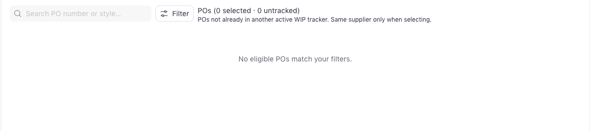
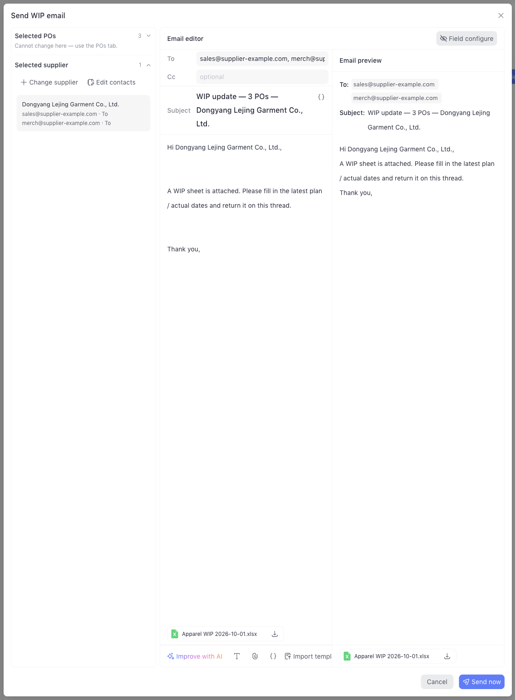

A **WIP tracker** groups the orders you follow up on with one supplier. Each tracker has a weekly deadline: SourceReady emails the supplier a WIP sheet for those orders before it, and reminds them if they haven't written back. Every reply lands in [Inbox](/inbox), where you review the proposed milestone updates and apply them.

Open trackers from **Order → WIP tracker** in the left sidebar.

<Note>
  A tracker is for **one supplier**, and an order can be in only **one active
  tracker** at a time. When you pick orders, the tracker locks to the supplier
  of the first one, and orders already in another active tracker aren't offered.
</Note>

## The tracker list

<Frame caption='The WIP tracker list, with one tracker expanded to show its orders.'>
  
</Frame>

Each row shows the tracker's supplier, owner, status, how many orders it links, and how many are at risk or delayed. Click the arrow on a row to see its orders, or click the name to open it.

<table>
  <colgroup>
    <col width='147' />
    <col width='484' />
  </colgroup>
  <thead>
    <tr>
      <th>Status</th>
      <th>Meaning</th>
    </tr>
  </thead>
  <tbody>
    <tr>
      <td>**Draft**</td>
      <td>Saved but not submitted yet. Open it and click **Submit tracker**</td>
    </tr>
    <tr>
      <td>**In progress**</td>
      <td>Active, and no order is at risk</td>
    </tr>
    <tr>
      <td>**Delayed / At risk**</td>
      <td>At least one order needs attention</td>
    </tr>
  </tbody>
</table>

## Create a tracker

There are four ways to start a tracker or add orders to one:

<table>
  <colgroup>
    <col width='196' />
    <col width='496' />
  </colgroup>
  <thead>
    <tr>
      <th>From</th>
      <th>How</th>
    </tr>
  </thead>
  <tbody>
    <tr>
      <td>**WIP tracker** list</td>
      <td>Click **New WIP tracker** and pick orders</td>
    </tr>
    <tr>
      <td>**Orders** list</td>
      <td>
        Select orders, click **Add to WIP tracker**, then pick a tracker or
        click **New WIP tracker with these POs**. See [Bulk
        actions](/orders#add-to-a-wip-tracker)
      </td>
    </tr>
    <tr>
      <td>An order's **Updates** tab</td>
      <td>
        Click **Create WIP tracker**. See [Order
        details](/order-details#updates-tab)
      </td>
    </tr>
    <tr>
      <td>A tracker's **Orders** tab</td>
      <td>Click **Add PO** to add more orders</td>
    </tr>
  </tbody>
</table>

To create one from the tracker list:

<Steps>
  <Step title="Click New WIP tracker">
    Go to **Order → WIP tracker** and click **New WIP tracker**.
  </Step>
  <Step title="Name it">
    Type a **WIP name**, such as "Dongyang Fall 2026", and choose an **Owner**.
  </Step>
  <Step title="Pick the orders">
    Search or **Filter** the list, then check the orders to include. The list only shows orders that aren't in another active tracker. After your first pick, the tracker is locked to that order's supplier, shown as **Supplier locked**.

    <Frame caption="Picking orders for a new tracker.">
      
    </Frame>

  </Step>
  <Step title="Set the follow-up schedule">
    **Send the WIP sheet automatically** is on by default: the supplier's update is due every Friday at 5:00 PM in your time zone, the sheet goes out 3 days before, and one reminder follows 1 day after the deadline if they haven't written. Change any of these, or turn the switch off to send only by hand. See [Follow-up schedule](#follow-up-schedule).
  </Step>
  <Step title="Create">
    Click **Create tracker**.
  </Step>
</Steps>

## Inside a tracker

<Frame caption="A tracker's Overview tab.">
  
</Frame>

<table>
  <colgroup>
    <col width='100' />
    <col width='601' />
  </colgroup>
  <thead>
    <tr>
      <th>Tab</th>
      <th>What's in it</th>
    </tr>
  </thead>
  <tbody>
    <tr>
      <td>**Overview**</td>
      <td>
        The linked orders with their current step and ship date, a **Watch
        list** of orders that need the supplier's confirmation, counts of
        linked, at-risk, and completed orders, and the **Follow-up** card
      </td>
    </tr>
    <tr>
      <td>**Orders**</td>
      <td>
        The tracker's orders in the same table as the [Orders list](/orders).
        Click **Add PO** to add more. Select orders and click **Remove from WIP
        tracker** to take them out, so they can join another tracker
      </td>
    </tr>
    <tr>
      <td>**WIP sheet**</td>
      <td>
        The sheet the supplier receives, filled with the tracker's orders. Set
        its columns here. See [The WIP sheet tab](#the-wip-sheet-tab)
      </td>
    </tr>
    <tr>
      <td>**Emails**</td>
      <td>
        Every email about the tracker's orders, newest first. See [The Emails
        tab](#the-emails-tab)
      </td>
    </tr>
  </tbody>
</table>

Click **Edit** to change the tracker's name or owner. The supplier can't be changed. From the **···** menu, **Complete tracker** when the orders are done, or **Cancel tracker** or **Delete** it. Completing or cancelling a tracker stops its automatic emails.

## Follow-up schedule

The **Follow-up** card on the **Overview** tab shows the schedule, when the sheet was last sent, when the next one goes out, and whether the supplier has written since: **Supplier wrote …**, or **No reply yet** with the time of the next reminder.

Click **Schedule** to change it:

- **Supplier update due every**: the weekly deadline, as a day and time in your time zone.
- **Send the WIP sheet**: how many days before the deadline the sheet goes out, at 9:00 AM. The sheet uses the columns set on the [WIP sheet tab](#the-wip-sheet-tab).
- **If the supplier hasn't written, remind**: how many days after the deadline, and up to how many times. A reminder is a reply on the same thread with an up-to-date sheet. Any supplier email linked to the tracker's orders after the last send stops the reminders, even a short "noted" on the thread. See [When the supplier replies](#when-the-supplier-replies) for how emails are linked.

Turn off **Send the WIP sheet automatically** to pause. Click **Send now** on the card to send the sheet right away.

<Note>
  Automatic emails need the WIP inbox mailbox connected in **Settings → Order
  → Inbox**. Without it, supplier replies can't be read, so nothing is sent.
</Note>

## The WIP sheet tab

The **WIP sheet** tab shows the whole sheet the supplier receives, filled with every order in the tracker. The columns you set here are the only sheet layout: **Send now**, the scheduled sends, and reminders all attach this sheet.

- **Order columns**: choose extra order details to include, such as item name, customer, quantity, or ex-factory date. **PO #** and **Style #** are always included, so the returned sheet can be matched to your orders.
- **On each milestone**: turn **Plan date**, **Actual date**, and **Notes** on or off for every milestone, or click **Per milestone** to set them one by one. Each milestone becomes a group of columns.
- The milestones come from the [profile](/milestones) most of the tracker's orders use, or your default profile. The tab names it under the title.
- Changes save automatically. There's no Save button.
- Click **Download .xlsx** to download exactly what the preview shows.

A completed or cancelled tracker's sheet is read-only, but you can still download it.

## Email the supplier

<Steps>
  <Step title="Open the email">
    On the tracker's **Emails** tab, click **Email supplier**. The **Send WIP email** dialog opens with the tracker's orders, the supplier's contacts, a ready-made message, and the WIP sheet attached.

    <Frame caption="The Send WIP email dialog, with the WIP sheet attached.">
      
    </Frame>

  </Step>
  <Step title="Check the recipients">
    The supplier's contacts are filled in under **To**. Click **Edit contacts** to add or change contacts, and choose for each one whether it **Receive emails** or gets **Auto CC**. Add anyone else under **Cc**.
  </Step>
  <Step title="Check the message">
    Edit the subject and message as you like, or click **Improve with AI**. The attached sheet uses the columns from the [WIP sheet tab](#the-wip-sheet-tab). The **Email preview** on the right shows what the supplier will see.
  </Step>
  <Step title="Send">
    Click **Send now**. The email appears in the tracker's **Emails** tab, and on the **Emails** tab of each order in it.
  </Step>
</Steps>

<Tip>
  The default message asks the supplier to "fill in the latest plan / actual
  dates and return it on this thread". Keep that line: a reply **on this
  thread** is linked to the tracker's orders without any PO numbers in it.
</Tip>

## When the supplier replies

Every supplier email, whether it's a reply or a new message, goes to [Inbox](/inbox) as **Needs review**. Nothing on your orders changes until you check the proposed milestone updates there and click **Apply**. Each updated order's health and risk are then checked again, and its [Activity](/order-details#activity) shows the update.

An email shows up on a tracker when it's linked to at least one of the tracker's orders:

- A reply on a thread is linked to the same orders as the email it answers.
- An email naming PO or style numbers is linked to those orders.
- Anything else, such as a new email with no PO, is linked when you pick the order in Inbox.

To answer the supplier, click **Reply** in Inbox. Replies are sent from the WIP mailbox and stay on the same thread.

## The Emails tab

The tracker's **Emails** tab lists every email linked to its orders, newest first. An order's **Emails** tab lists the emails linked to that order. Each email has **Reply**, and supplier emails have **Review in Inbox** to open their review.

## Next

<Columns cols={2}>
  <Card title="Orders" icon="table-list" href="/orders">
    See how the supplier's update changed each order's health.
  </Card>

  <Card title="Milestones" icon="list-check" href="/milestones">
    Change which steps and dates the WIP sheet asks for.
  </Card>
</Columns>
